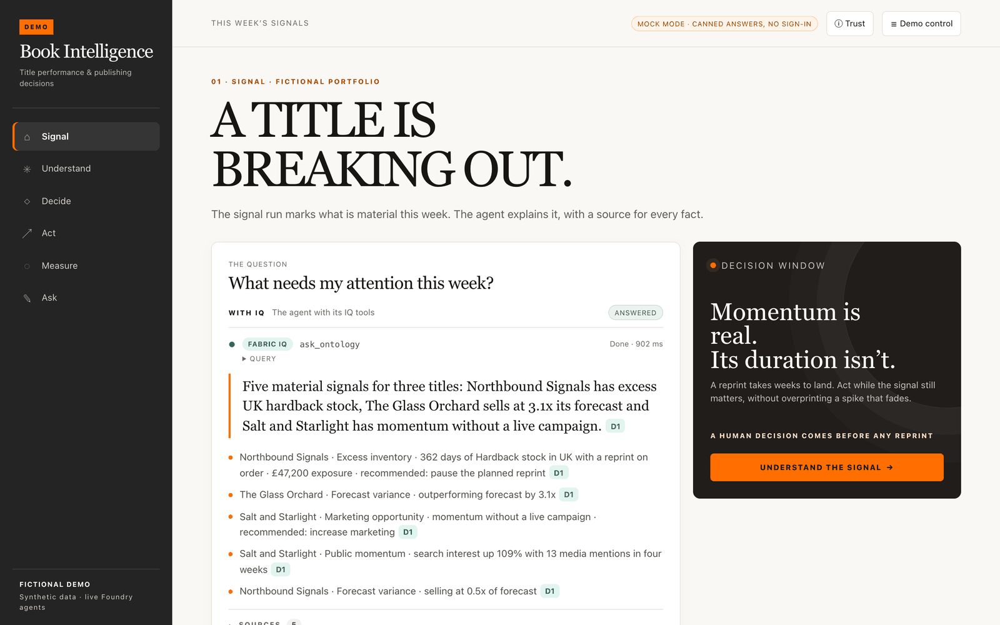

# Book Intelligence

Microsoft IQ for a publisher's weekly title decisions. The commercial team asks which titles need attention, finds out
why they're moving, weighs the options and approves a reprint, and the next signal run shows whether the decision
landed. Every answer cites its sources: live sales and stock through **Fabric IQ**, approved policy through **Foundry
IQ**, public coverage through **Web IQ** and, as an option, the team's mail through **Work IQ**.

A proof of concept on Microsoft Fabric, Microsoft Foundry and Azure Container Apps, built on the
[Fabric + Foundry IQ template](https://github.com/microsoftgbb/iq-template). The publisher, its titles, authors,
documents and figures are fictional, and the data is synthetic.

> [!IMPORTANT]
> This proof of concept is provided as is, without warranty or support, and you use it at your own risk.
> Deploying it creates billable Azure and Fabric resources, registers Entra applications and uses
> preview features. Read the [disclaimer](#disclaimer) before you deploy.

[](docs/images/book-intelligence-signal.png)

*The Signal page in mock mode, with canned answers. Deployed, the agent answers live, as the signed-in user.*

## The story

The app follows one week at the fictional publisher: the week of 2 November 2026. Each step asks the agent one
question, and its cited answer fills the page.

| Step | The question | Answered from | What it shows |
| --- | --- | --- | --- |
| **Signal** | What needs my attention this week? | Fabric IQ | Five material signals from the live ontology. *The Glass Orchard* is selling at 3.1x its forecast. |
| **Understand** | Why is it moving? | Fabric IQ, Foundry IQ, Web IQ and, opt-in, Work IQ | One tab per IQ: the title's sales against its forecast and where, the reprint policy cited by section, public context on prize shortlists, and the team's mail. |
| **Decide** | What are the options for The Glass Orchard, and who may approve the recommended one? | Fabric IQ, Foundry IQ | Each option from its own row, from an expedited reprint to reallocating stock, and the approver the decision authority matrix names: the publishing director. |
| **Act** | Submit an expedited reprint request for The Glass Orchard. | Fabric IQ, then the reprint request | The agent holds the request, and a decision card shows every value: 20,000 UK hardback copies, expedited, for £50,000. Nothing is submitted until the user approves. |
| **Measure** | Which inventory risks are open or actioned, and which reprint requests are recorded? | Fabric IQ | The request goes from proposed to approved to recorded, and the next signal run marks the risk *Actioned* in the data. |

**Compare without IQ** puts the same agent without its tools beside any answer: same model, same instructions, and it
can't name a single title. **Ask** takes any question, with IQ, without or both. **How I got this** opens an answer's
route, its tool calls with their queries, its evidence and its steps.

### Why the answers hold up

- **A source for every fact.** Each fact carries a marker: `[D1]` for ontology rows, `[F1 §2]` for a section of an
  approved document, `[Web1]` for public context, `[W1]` for mail and `[A1]` for a recorded reprint request. *Sources*
  and *Steps* follow ([reply format](docs/architecture.md#reply-format)).
- **Facts from data, rules from documents.** Figures come from the live ontology, never totalled or estimated;
  thresholds, approval limits and definitions come from the approved documents.
- **Public terms only.** A Web IQ search never names a title, an author, an imprint or the company.
- **One governed action.** Every tool is read-only except the reprint request, which the signed-in user approves or
  rejects in the app. The reprint server checks their approval role and the week's governed option before it records
  anything, and approving the same request again returns the existing record.
- **A measured outcome.** Approval isn't the result: the next `ComputeBookSignals` run copies the recorded request
  and marks the inventory risk *Actioned*, which the agent then reads back.

## The data and documents

- **Portfolio:** eight titles in hardback, paperback, ebook and audio, with 26 weeks of sales, forecasts, stock and
  public signals across the UK, US and ANZ, from the week of 11 May to the week of 2 November 2026, and their
  campaigns ([data contract](scenario/data/README.md)).
- **Signals and options:** `ComputeBookSignals` applies fixed rules to the latest week (forecast variance, inventory
  risk, excess inventory, public momentum and marketing opportunity) and models each signal's options, recommending
  one ([rules](scenario/data/README.md#rules)).
- **Ontology:** `BooksOntology` maps seven tables, from titles and editions to signals, options and reprint
  requests, to the entities Fabric IQ queries live, as the signed-in user.
- **Approved documents:** six governed documents, among them the reprint and stock policy, the marketing investment
  guidelines and the decision authority matrix, which Foundry IQ retrieves and cites by section
  ([approved documents](scenario/knowledge/README.md)).
- **Reprint requests:** the `BookSignals` KQL database, in the `BookEvents` Eventhouse, records each approved request
  and each signal run.

## Present it

1. **Before the session,** resume the Fabric capacity if it's paused, open the app (`terraform -chdir=infra output
   app` prints its URL) and sign in. Then run the evals from the deployment checkout, because a model can answer
   differently from one run to the next:

   ```sh
   python3 .github/skills/runtime-integration/scripts/run_evals.py
   ```

   They ask every case as you, judge the tool calls, sources and figures, and reject the one reprint request a case
   proposes ([evals](scenario/evals/README.md)).
2. **Tell the story** with **Demo control > Start guided story**, which opens each page in turn and asks its question,
   or select **Ask the agent** on each page yourself. A live answer can take a minute. The guided story ends on a
   reveal of the four IQs, with this session's calls and sources.
3. **Approve only when you mean it.** DEV can't take an approval back. **Reject** shows the whole flow without
   recording anything, and once the week's request is recorded, approving again returns that record.
4. **Advance a week,** if you want the next chapter: in the DEV workspace, run the `SeedBooks` notebook with
   `through_week = 27`, then `ComputeBookSignals`. In the week of 9 November, *The Glass Orchard*'s UK hardback
   becomes a material risk, with 14 days of cover against a 35-day reprint lead time
   ([storyline](scenario/data/README.md#storyline)). Seeding is insert-only, so this can't be undone; run the evals
   with `--week 27` afterwards.
5. **Without a deployment,** run `npm ci` and then `npm run dev:mock` in `app/`: the whole story plays at
   `http://localhost:3000/` with canned answers, including the approval flow, with no sign-in and no Azure
   ([app commands](app/README.md#commands)).

Other people need an operator to grant them access to the agents and the ontology's data and, to approve reprint
requests, an approval role; a deployment assigns them only to the deployer
([access model](docs/runtime-integration.md#access-model)).

## How it works

[](docs/diagrams/platform-architecture.svg)

The browser signs the user in, and the app's server checks their token before it asks a Foundry prompt agent as them.
The agent with IQ reaches:

| IQ | What it knows | Runs as |
| --- | --- | --- |
| Fabric IQ | `BooksOntology`, queried live over the `Books` lakehouse | The signed-in user |
| Foundry IQ | The approved documents, indexed from the lakehouse | The Foundry project's managed identity |
| Web IQ | Public coverage, through Web IQ's MCP server | The project's managed identity, keyless |
| Work IQ (opt-in) | The user's own mail | The signed-in user |

Its one action reaches the reprint request server as the user, once they approve it, and the server records the
request as its own identity, which holds only Database Viewer and Ingestor on `BookSignals`. The agent without IQ
shares the model and the instructions and has no tools. Each question is one trace in Application Insights, from the
app's server through the agent run to every tool call.

[Components and ownership](docs/architecture.md) | [Runtime and identity](docs/runtime-integration.md#runtime-at-a-glance) |
[Indexed vs. live knowledge](docs/ontology-knowledge.md#two-retrieval-paths) | [All diagrams](docs/diagrams/README.md)

## Deploy it

1. Open this repository in a **Codespace** for the prepared toolchain, or follow [developer setup](docs/development.md)
   for a local environment. The devcontainer includes the [official Azure/Foundry IQ, Work IQ/M365 Agents Toolkit and
   Fabric/Fabric IQ Copilot packages](docs/copilot-tooling.md); installing them doesn't sign in, grant consent or
   enable optional runtime integrations.
2. Work through the [manual preparation checklist](preparation.md). The
   [prerequisites](docs/getting-started.md#prerequisites) name who provides each permission, tenant setting and quota,
   and how long it usually takes. Web IQ needs the subscription enabled and its terms accepted before you deploy, and
   the project identity bound in the Web IQ portal after knowledge setup ([Web IQ](docs/getting-started.md#web-iq)).
3. Tell Copilot **"Deploy the platform"**. With Copilot App and Codespaces, name the Codespace to keep the deployment
   in that checkout and state. To deploy without Copilot, run the same
   [deterministic runner](docs/development.md#deploy-deterministically) yourself:
   `python3 .github/skills/deploy-platform/scripts/deploy.py up`. It stops to ask for any missing choice, such as the
   subscription, and finishes with the reprint request server running, both agents published and the web app at its
   Container Apps URL.

You choose the target, complete every sign-in once at the start and approve each plan. The runner assumes you're an
administrator, grants consent as you and names a specific grant only if an API refuses. For **configuration only**,
use **/initialize-project**. Fabric bootstrap uses native APIs and needs **no GitHub PAT**; set
`fabric_git_enabled = true` to opt into Fabric GitHub synchronization. Optional inputs, such as `work_iq_enabled`,
`knowledge_folders`, `agent_model`, `app` and `reprint_min_replicas`, are listed under
[configuration keys](docs/getting-started.md#configuration-keys).

Each deployment keeps its Terraform state in its own checkout. Keep that Codespace, move the state to an encrypted,
access-controlled remote backend before team or CI use, and never copy another deployment's tfvars or state.

Use one explicit region. `location` is also the Foundry and app region, so it must offer Foundry with the agent, chat
and embedding models, Azure Container Apps and Container Registry. Check Fabric CU quota first; the default
serverless Search tier is offered in fewer regions than dedicated tiers, which also have new-service capacity limits.
Approved `fabric_location` / `search_location` overrides can retain working Foundry resources when a service is
unavailable in that region.

[](docs/diagrams/deployment-flow.svg)

[Deployment stages and approval gates](docs/deployment-flow.md) | [Single-prompt setup](docs/development.md#deploy-from-one-prompt)

<details>
<summary><b>What a deployment creates</b></summary>

- **Azure:** resource group, Fabric capacity, container registry, Log Analytics and Application Insights (Entra ID only, no ingestion key), and a Container Apps environment with the web app and the reprint request server.
- **Identity/access:** Entra deployment app/service principal, delegated scopes, authorized clients, the web app's single-page sign-in registration, the reprint request server's API registration with its four approval roles and its connection's public OAuth client, the Work IQ registration only with Work IQ, managed identities and role assignments.
- **Fabric:** DEV/TEST workspaces and DEV-to-TEST deployment pipeline; GitHub credentials connection only with Git synchronization enabled.
- **DEV items:** `Books` lakehouse, `SeedBooks`, `ComputeBookSignals`, `BooksOntology`, `BindBooks`, `PublishBooksKnowledge`, the `BookEvents` Eventhouse with its `BookSignals` KQL database, and `Bootstrap` deployment plan.
- **Seed data:** a fictional book portfolio: 8 titles, 18 editions, 26 weeks of sales, stock, public signals and campaigns, the latest week's signals and decision options computed from them, and `Files/documents/starter.txt` ([data contract](scenario/data/README.md)), with the six [approved documents](scenario/knowledge/README.md), such as the reprint and stock policy, published beside it.
- **Foundry:** account, project, `agent`/`chat`/`embedding` model deployments, and Search, knowledge-base, keyless Web IQ, Fabric IQ, reprint request, Application Insights and, only with Work IQ, Work IQ connections.
- **Search:** service, one indexed OneLake source per knowledge folder with its generated ingestion assets, the agents' knowledge base, and a check-only knowledge base with the live ontology source.
- **Web IQ:** global G3 account, called keyless as the Foundry project identity; linking the AppID and binding that identity in the portal is manual.
- **Prompt agents:** `<project>-with-iq`, with the Fabric IQ, Foundry IQ, Web IQ and, opt-in, Work IQ mail tools and the approval-gated reprint request tool, and `<project>-without-iq`, with none, published by the deployment runner.
- **Web app:** the React page and its Node server in one container, at a public HTTPS URL.
- **Reprint request server:** the agents' one action, an MCP server in its own container app. It records a reprint request that the signed-in user approved in the app, after checking their approval role and the week's governed option, in the `BookSignals` KQL database ([reprint request server](scenario/workflows/reprint-request/README.md)).
- **Tracing:** one Application Insights operation per question, from the web app's server through the agent run to each tool call; Foundry's message content goes only to a protected table the deployer can read.

</details>

## What is where

| Path | Contains |
| --- | --- |
| [`app/`](app/README.md) | The web app: the guided story in React, the Node server that verifies each user's token and asks the agents, mock mode and the image. |
| [`agents/`](agents/README.md) | The two variants of the book performance assistant: shared `agent.json` and `instructions.md`, and the with-IQ variant's `tools/`. |
| [`scenario/`](scenario/data/README.md) | The portfolio's [data contract](scenario/data/README.md), the [approved documents](scenario/knowledge/README.md), the [evals](scenario/evals/README.md) and the [reprint request server](scenario/workflows/reprint-request/README.md). |
| [`workspace/`](workspace/) | Fabric items: the `Books` lakehouse, the seed, signal, document-publishing and bind notebooks, `BooksOntology`, the `BookEvents` Eventhouse with `BookSignals`, and the bootstrap plan. |
| [`infra/`](infra/) | Terraform: Entra, Fabric, Foundry, Search, Web IQ, optional Work IQ, knowledge registration, the agents' connections and the hosting of the app and the reprint request server. |
| [`cicd/`](cicd/README.md) | Native Fabric bootstrap and promotion. |
| [`docs/`](docs/getting-started.md) | Guides, starting with [getting started](docs/getting-started.md), and the [scenario authoring contract](docs/scenario-authoring.md) for changing the domain. |
| [`.github/skills/`](.github/skills/) | Copilot skills that run each workflow. |

## Limits

- **DEV only.** The agents, the app and the reprint request server serve DEV. TEST stays empty until a reviewed
  [native promotion](cicd/README.md); PROD, production ingestion and hardening such as private networking aren't
  included.
- **Previews.** Fabric ontology, deployment plans, Foundry IQ, the Fabric IQ agent tool, serverless Search and Web IQ
  are previews. Endpoints, including the web app and the reprint request server, are authenticated but public.
- **One user's evidence.** A run proves the route for one account. Isolation between users stays unverified until a
  second account proves it ([evidence for a ready shell](docs/runtime-integration.md#evidence-required-for-a-ready-shell)).
- **Work IQ is opt-in:** `work_iq_enabled = false` by default. It needs a mailbox per user, a Copilot Credits spending
  policy that covers the Work IQ API, administrator consent and each user's one-time consent
  ([Work IQ](docs/getting-started.md#work-iq)).
- **Costs.** The Fabric capacity, Search, model tokens, every Web IQ call and the two container apps bill while
  deployed. Between sessions, pause the Fabric capacity and set `app = { min_replicas = 0 }` and
  `reprint_min_replicas = 0`; the first question afterwards waits for a cold start.

## Delete the environment

From the original deployment checkout, with its tfvars, backend and deployment receipts:

```sh
python3 .github/skills/deploy-platform/scripts/deploy.py down --non-interactive
```

Review the saved destroy plan, then approve the reported hash and native deletions:

```sh
python3 .github/skills/deploy-platform/scripts/deploy.py down --non-interactive \
  --allow-delete --approve "destroy=<sha256-prefix>" --approve purge-foundry
```

One reviewed Terraform destroy plan deletes every Terraform resource, including the
container app, its registry and sign-in registration, the reprint request server with
its registrations, the Foundry project with both agents, Application Insights and the
Search ingestion assets; the runner then purges the Foundry account. **Both Fabric
workspaces and all their contents are deleted**, including the recorded reprint
requests. `--yes` cannot approve teardown. Rerun `down` to resume.

Remaining cleanup:

- **Fabric tenant admin:** permanently delete the retained DEV/TEST workspaces; [retention still applies](https://learn.microsoft.com/en-us/fabric/admin/workspace-retention).
- **Microsoft Entra:** deleted app registrations stay under **Deleted applications** for 30 days; restore or permanently delete them there.
- **Web IQ portal:** unbind the project identity and remove the AppID/profile.
- **Preserved:** GitHub repository, local files/state, backend storage, tenant settings, licenses and external source data.

[Teardown details](docs/development.md#delete-the-environment)

## Contributing

Changes go through pull requests into `main`, and CI checks every pull request without secrets or cloud access; start
with [CONTRIBUTING.md](CONTRIBUTING.md). Contributors and Copilot follow [AGENTS.md](AGENTS.md): above all, keep
everything in the scenario fictional, and never commit credentials, tfvars, state or deployment IDs. Keep **Template
repository** off in GitHub **Settings > General**, because the deployment runner refuses to deploy from a template
repository.

This project has adopted the [Microsoft Open Source Code of Conduct](https://opensource.microsoft.com/codeofconduct/).
Report security issues as described in [SECURITY.md](SECURITY.md); for help, see [SUPPORT.md](SUPPORT.md).

## Disclaimer

This proof of concept is a sample for development and evaluation. It is not supported under any Microsoft
standard support program or service, and it is provided AS IS without warranty of any kind.
Microsoft further disclaims all implied warranties including, without limitation, any implied
warranties of merchantability or of fitness for a particular purpose. The entire risk arising out
of the use or performance of the sample and its documentation remains with you. In no event
shall Microsoft, its authors, or anyone else involved in the creation, production, or delivery of
the sample be liable for any damages whatsoever (including, without limitation, damages for loss
of business profits, business interruption, loss of business information, or other pecuniary loss)
arising out of the use of or inability to use the sample or its documentation, even if Microsoft
has been advised of the possibility of such damages.

You use the sample at your own risk. In particular, you are responsible for:

- **Costs:** deployment creates billable Azure and Fabric resources, such as Fabric capacity,
  Azure AI Search, Foundry models, Container Apps, the container registry, Application Insights,
  Web IQ and, when enabled, Work IQ's Copilot Credits, that can incur charges until you
  [delete the environment](#delete-the-environment). Check pricing and quota first.
- **Preview features:** Fabric ontology, deployment plans, Foundry IQ, the Fabric IQ agent tool,
  serverless Search and Web IQ are previews. They are subject to the
  [Supplemental Terms of Use for Microsoft Azure Previews](https://azure.microsoft.com/support/legal/preview-supplemental-terms/)
  and their own terms, and may change or stop working without notice.
- **Your tenant and data:** deployment registers Entra applications, needs administrator consent,
  assigns roles and processes the data you add. Review every plan and permission before you
  approve it, and follow your organization's policies and applicable law.
- **Security and production use:** this is a development baseline with authenticated public
  endpoints, not a hardened production system. Complete your own security, privacy, compliance
  and Responsible AI reviews before any production use.
- **AI output and automation:** AI models and agents, including Copilot, can produce inaccurate or
  inappropriate output, and Copilot can run deployment commands for you. Check their output and
  every plan before you approve it.
- **Third-party components:** the tools, packages, plugins and services that the sample
  installs or calls have their own licenses, terms and privacy statements, and some collect
  usage data.

## License

This project is licensed under the [MIT License](LICENSE). Third-party icons in the architecture
diagrams have their own terms; see [docs/diagrams/LICENSE](docs/diagrams/LICENSE).

## Trademarks

This project may contain trademarks or logos for projects, products, or services. Authorized use of Microsoft
trademarks or logos is subject to and must follow
[Microsoft's Trademark & Brand Guidelines](https://www.microsoft.com/legal/intellectualproperty/trademarks/usage/general).
Use of Microsoft trademarks or logos in modified versions of this project must not cause confusion or imply Microsoft sponsorship.
Any use of third-party trademarks or logos are subject to those third-party's policies.
